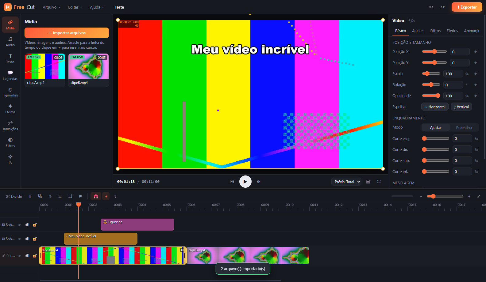
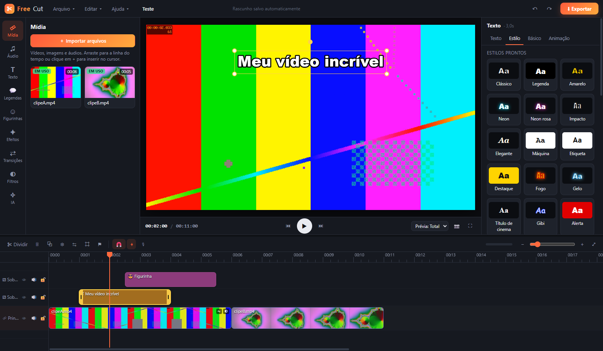
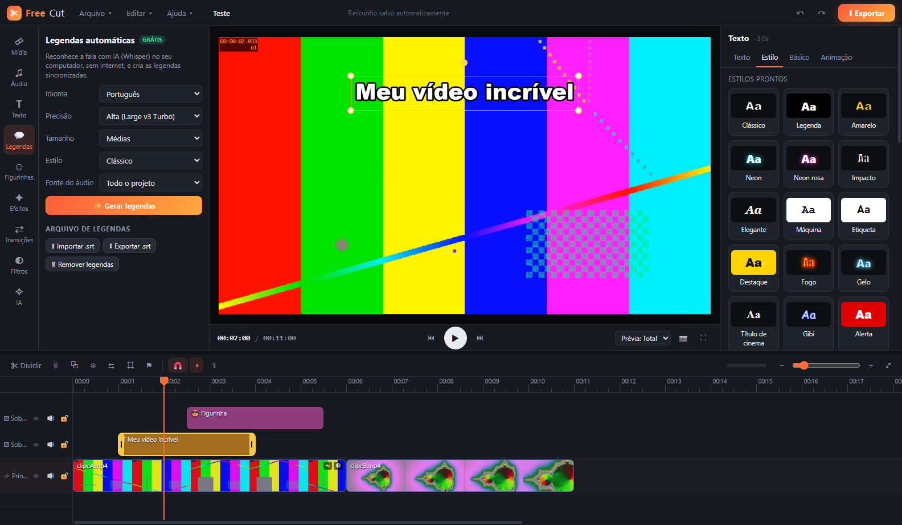

<p align="center"></p>

<h1 align="center">FreeCut</h1>

<p align="center"><b>Editor de vídeo para Windows com recursos de nível profissional, todos gratuitos.</b><br>
Sem marca d'água, sem assinatura e sem nuvem: tudo roda no seu computador.</p>

<p align="center"><a href="../../releases/latest"><b>⬇ Baixar o instalador para Windows</b></a></p>



## Destaques

- 🎬 **Exportação até 4K 60 fps** em MP4 (H.264 + AAC), com codificação pela placa de vídeo e sem marca d'água
- 💬 **Legendas automáticas com IA** (Whisper) sem internet, em português e outros idiomas, com importação e exportação SRT
- 👤 **Remoção de fundo por IA** sem tela verde, além de **chroma key**
- 🗣 **Texto para fala** com as vozes do Windows (ex.: Maria, pt-BR)
- 🎚 **Redução de ruído**, normalização e **11 efeitos de voz** (robô, esquilo, monstro, eco, rádio…)
- ✂ **Remover silêncios** automaticamente e **detectar batidas** da música
- ⏱ **Velocidade de 0,1x a 100x** e **curvas de velocidade** (Montagem, Herói, Bala…)
- ◆ **Keyframes** em posição, escala, rotação, opacidade, volume e cor
- 🎨 **28 filtros**, **14 ajustes de cor**, **23 efeitos**, **22 transições**, **máscaras** e **16 modos de mesclagem**
- 🔤 Texto com contorno, sombra, fundo, neon, karaokê e **animações** de entrada, saída e contínuas
- 🛠 **Estabilização**, **reverter**, **congelar quadro**, extrair áudio, narração pelo microfone, efeitos sonoros
- 📐 7 proporções (16:9, 9:16, 1:1, 4:5, 4:3, 3:4, 21:9) e fundo desfocado

| Estilos de texto | Legendas automáticas |
|---|---|
|  |  |

## Instalação

Baixe o **`FreeCut-Setup-x.y.z.exe`** em [Releases](../../releases/latest) e execute. Ele instala só para o seu usuário, sem pedir administrador, e cria atalhos na área de trabalho e no Menu Iniciar.

> O Windows SmartScreen pode avisar "aplicativo não reconhecido" porque o instalador não tem assinatura digital paga. Clique em **Mais informações → Executar assim mesmo**.

**Requisitos:** Windows 10/11 64 bits. As legendas por IA ficam bem mais rápidas com uma placa NVIDIA (CUDA); sem ela, funcionam pelo processador.

## Atalhos

| Tecla | Ação | Tecla | Ação |
|---|---|---|---|
| Espaço | reproduzir/pausar | S | dividir |
| Delete | excluir | Shift+Delete | excluir e fechar lacuna |
| Ctrl+D | duplicar | Ctrl+C / V | copiar / colar |
| Ctrl+Z / Y | desfazer / refazer | ← / → | quadro anterior / próximo |
| ↑ / ↓ | corte anterior / próximo | Q / W | aparar até o cursor |
| M | marcador | T | texto |
| Ctrl+S | salvar | Ctrl+E | exportar |

Lista completa no app: **F1**.

## Rodar a partir do código

```powershell
git clone https://github.com/freecut-app/FreeCut.git
cd FreeCut
npm install
# baixa ffmpeg, whisper.cpp e os modelos de IA (~1,5 GB; use -SemCuda e/ou -SemTurbo para a versão leve)
powershell -ExecutionPolicy Bypass -File scripts/setup-resources.ps1
npm start
```

| Comando | O que faz |
|---|---|
| `npm start` | abre o app em modo de desenvolvimento |
| `npm test` | teste ponta a ponta no app real (importa, edita, gera legendas e exporta) |
| `npm run dist` | gera o instalador em `dist/` |
| `npm run icon` | regera o ícone a partir de `build/icon.svg` |

## Como funciona

```
main.js        processo principal: protocolo freecut:// (com Range), diálogos, ffmpeg,
               Whisper, texto para fala (SAPI), mixagem de áudio e montagem do MP4 final
src/js/
  store.js      modelo do projeto, tempo e curvas de velocidade, keyframes, edição, histórico
  engine.js     compositor (Canvas 2D + WebGL2): animações, transições, máscaras, texto, sincronia
  gl.js         shader: cor, filtros, efeitos, chroma key e máscara da IA
  segment.js    remoção de fundo (MediaPipe Selfie Segmenter)
  timeline.js   linha do tempo        inspector.js  painel de propriedades
  panels.js     biblioteca e IA       exporter.js   exportação (WebCodecs → MP4 → ffmpeg)
```

A prévia e a exportação usam o mesmo compositor, então o que você vê é o que sai. Na exportação, cada quadro é codificado em H.264 pela GPU (WebCodecs) e gravado no MP4 em partes. Depois, o ffmpeg mistura todas as faixas de áudio (corte, velocidade, volume com keyframes e fades) e monta o arquivo final.

## Limitações conhecidas

- Não há bibliotecas online de modelos, músicas ou figurinhas. As figurinhas são emojis e os efeitos sonoros são sintetizados pelo próprio app.
- Clipes com curva de velocidade ficam sem áudio.
- A exportação fica perto do tempo real em 720p/1080p e é mais lenta em 4K.
- A remoção de fundo foi treinada para pessoas.

## Licença

Código sob a licença [MIT](LICENSE). O instalador inclui FFmpeg (GPL), whisper.cpp, MediaPipe e outros componentes; veja [THIRD_PARTY_NOTICES.md](THIRD_PARTY_NOTICES.md).

*FreeCut é um projeto independente, sem afiliação com o CapCut ou a ByteDance.*
